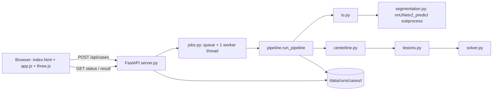

# TwinLoop v1 — Specification

This document is self-contained. If anything here conflicts with your own judgment, follow this document. Where two reasonable options exist, the chosen one is marked **DEFAULT**.

---

## 1. Product summary

TwinLoop is a research prototype that estimates CT-derived fractional flow reserve (CT-FFR) from a coronary CT angiography (CCTA) scan, as a cheap and fast alternative to HeartFlow for Indian hospitals.

**Background you need:**
- *FFR* = pressure at a point in a coronary artery ÷ pressure in the aorta, during maximal blood flow (hyperemia). 1.0 = no obstruction. **≤ 0.80 = functionally significant** narrowing.
- *CCTA* = a 3D CT scan of the heart with contrast dye; arteries look bright.
- *Coronary trees*: there are two (left and right), each starting at an *ostium* (where it leaves the aorta) and branching outward.
- *Stenosis* = a narrowing. *Diameter stenosis (DS)* = 1 − r_min / r_reference.

**Pipeline (per scan):**
1. Load image (NIfTI or zipped DICOM) → reorient to LPS.
2. Segment coronary arteries → binary mask (nnU-Net v2), OR use a mask the user supplied.
3. Extract centerlines + radius along each branch → a tree of branches.
4. Detect stenoses (lesions) on each branch.
5. Solve a steady-state reduced-order (1D) hemodynamics model → pressure → FFR at every centerline point.
6. Write `result.json`; the web viewer renders a 3D tree coloured by FFR plus a lesion table.

**Definition of done for v1:**
- `docker` image builds on the DGX Spark; all unit/integration tests pass; `ruff` is clean.
- nnU-Net trained on ImageCAS (single fold), evaluated on the held-out test split, numbers in `reports/RESULTS.md`.
- A user can open `http://127.0.0.1:8010`, upload an ImageCAS `.nii.gz` (or zipped DICOM series) and within 5 minutes see the coloured FFR tree, click any vessel for its FFR value, and see a lesion table.
- Pipeline evaluation on 20 held-out cases is written to `reports/RESULTS.md`, including failures.

**Honesty constraint:** there is NO invasive-FFR ground truth in this project. FFR values are **unvalidated**. Never write or display any claim of clinical accuracy. Every screen and every `result.json` carries the disclaimer string in §6.3.

---

## 2. Environment

### 2.1 Hardware (verify in task T00)
- NVIDIA DGX Spark, GB10 Grace-Blackwell. **ARM64 (aarch64) CPU.** ~128 GB unified memory shared by CPU and GPU (the owner budgets ~70 GB for GPU work). Verify with `uname -m`, `nvidia-smi`, `free -h`, `df -h`.
- Consequence: all Python runs inside NVIDIA's NGC PyTorch container (it ships an ARM build of PyTorch with GB10 support). Never `pip install torch`.

### 2.2 Directories
- Repo: wherever the owner cloned it (example `~/twinloop`). Inside containers it is mounted at `/workspace/twinloop`.
- Data root on host: env var `TWINLOOP_DATA` (**DEFAULT** `$HOME/twinloop-data` if unset). Mounted at `/data` in containers. Never inside the repo; never committed.

```
/data/
  raw/imagecas/                 # downloaded ImageCAS (read-only after manifest is written)
  raw/imagecas/manifest.csv     # written by scripts/make_manifest.py
  nnUNet_raw/Dataset501_ImageCAS/{imagesTr,labelsTr,imagesTs,labelsTs,dataset.json}
  nnUNet_preprocessed/
  nnUNet_results/
  runs/cases/<case_id>/         # app + CLI outputs
  runs/eval/                    # evaluation predictions
```

### 2.3 Container
- Base image: `nvcr.io/nvidia/pytorch:<tag>-py3`. **Tag selection procedure (T00):** try `docker pull` on `26.09`, then `26.08`, `26.07`, `26.06`, `26.05`, `26.04`, `26.03`, `26.02`, `26.01`, `25.12`, `25.11`, `25.10`, `25.09` in that order; use the first that pulls AND passes `scripts/check_env.sh`. Write the chosen tag as the `ARG BASE_IMAGE` default in the Dockerfile and in `docs/DECISIONS.md`. If a pull asks for authentication, stop and log BLOCKED: the owner must run `docker login nvcr.io` (username `$oauthtoken`, password = NGC API key).
- `Dockerfile` (exact content; only the tag changes):

```dockerfile
ARG BASE_IMAGE=nvcr.io/nvidia/pytorch:26.09-py3
FROM ${BASE_IMAGE}
ENV PIP_NO_CACHE_DIR=1 PYTHONDONTWRITEBYTECODE=1 PYTHONUNBUFFERED=1
COPY requirements.txt /tmp/requirements.txt
RUN python -c "import torch; print('torch==' + torch.__version__)" > /tmp/constraints.txt \
 && pip install -c /tmp/constraints.txt -r /tmp/requirements.txt \
 && python -c "import torch; v=open('/tmp/constraints.txt').read().strip().split('==')[1]; assert torch.__version__ == v, (torch.__version__, v)"
ENV PYTHONPATH=/workspace/twinloop/src:/workspace/twinloop
WORKDIR /workspace/twinloop
```

If the `pip install -c` step fails to resolve because of torch, use this fallback and log it in DECISIONS.md: `pip install --no-deps nnunetv2 acvl-utils dynamic-network-architectures batchgenerators batchgeneratorsv2` then `pip install -c /tmp/constraints.txt -r /tmp/requirements.txt` with those five names removed from requirements.txt into a second file `requirements-nodeps.txt`; then run `pip check` and record its output.

- `requirements.txt` initial content (T00 later pins each to `==<installed version>`):
```
nnunetv2
SimpleITK
nibabel
scikit-image
scipy
networkx
pandas
pydantic>=2
fastapi
uvicorn[standard]
python-multipart
httpx
kaggle
pytest
ruff
```

- `scripts/dk` — run any command in the container (exact content):

```bash
#!/usr/bin/env bash
set -euo pipefail
REPO="$(cd "$(dirname "$0")/.." && pwd)"
DATA="${TWINLOOP_DATA:-$HOME/twinloop-data}"
mkdir -p "$DATA"
TTY_FLAG=""; [ -t 0 ] && TTY_FLAG="-it"
exec docker run --rm $TTY_FLAG --gpus all --ipc=host \
  --user "$(id -u):$(id -g)" -e HOME=/tmp \
  -v "$REPO":/workspace/twinloop -v "$DATA":/data \
  -v "$HOME/.kaggle":/kaggle:ro -e KAGGLE_CONFIG_DIR=/kaggle \
  -e nnUNet_raw=/data/nnUNet_raw -e nnUNet_preprocessed=/data/nnUNet_preprocessed \
  -e nnUNet_results=/data/nnUNet_results -e nnUNet_n_proc_DA=8 \
  -e nnUNet_compile="${nnUNet_compile:-true}" \
  -e TWINLOOP_DATA=/data -e TWINLOOP_NNUNET_TRAINER="${TWINLOOP_NNUNET_TRAINER:-nnUNetTrainer}" \
  -w /workspace/twinloop twinloop:dev "$@"
```
`mkdir -p "$HOME/.kaggle"` once (T00) so the mount never fails.

- Long-running jobs (download, preprocessing, training, server) run in **detached named containers** so they survive the Claude Code session. `scripts/dkd` (exact content):

```bash
#!/usr/bin/env bash
# usage: scripts/dkd <container-name> [--port] <command...>
# Starts a detached container. Removes an existing container of the same name first
# (only ever pass the twinloop-* names below).
set -euo pipefail
NAME="$1"; shift
PORT_FLAG=()
if [ "${1:-}" = "--port" ]; then PORT_FLAG=(-p 127.0.0.1:8010:8010); shift; fi
REPO="$(cd "$(dirname "$0")/.." && pwd)"
DATA="${TWINLOOP_DATA:-$HOME/twinloop-data}"
mkdir -p "$DATA"
docker rm -f "$NAME" >/dev/null 2>&1 || true
docker run -d --name "$NAME" "${PORT_FLAG[@]}" --gpus all --ipc=host \
  --user "$(id -u):$(id -g)" -e HOME=/tmp \
  -v "$REPO":/workspace/twinloop -v "$DATA":/data \
  -v "$HOME/.kaggle":/kaggle:ro -e KAGGLE_CONFIG_DIR=/kaggle \
  -e nnUNet_raw=/data/nnUNet_raw -e nnUNet_preprocessed=/data/nnUNet_preprocessed \
  -e nnUNet_results=/data/nnUNet_results -e nnUNet_n_proc_DA=8 \
  -e nnUNet_compile="${nnUNet_compile:-true}" \
  -e TWINLOOP_DATA=/data -e TWINLOOP_NNUNET_TRAINER="${TWINLOOP_NNUNET_TRAINER:-nnUNetTrainer}" \
  -w /workspace/twinloop twinloop:dev "$@"
echo "started $NAME"
```
Container names (only these): `twinloop-download`, `twinloop-prep`, `twinloop-train`, `twinloop-server`. **Never run `scripts/dkd twinloop-train ...` while training is running** — it would kill the run; check `docker ps` first. The server uses `--port`, which publishes on 127.0.0.1 only (**DEFAULT**; never `0.0.0.0` on the host). Watch any job with `docker logs --tail 20 <name>`; exit code with `docker inspect -f '{{.State.ExitCode}}' <name>`.

### 2.4 Environment variables (names only; never commit values)
| Name | Where | Meaning |
|---|---|---|
| `TWINLOOP_DATA` | host | data root, default `$HOME/twinloop-data` |
| `KAGGLE_CONFIG_DIR` | container | `/kaggle`, read-only mount of host `~/.kaggle`, which holds `access_token` (new-style Kaggle API token; no `kaggle.json`) |
| `KAGGLE_API_TOKEN` | container | only if needed (T01 step 0 fallback): read from host `~/.kaggle/access_token` at container start |
| `nnUNet_raw`, `nnUNet_preprocessed`, `nnUNet_results` | container | required by nnU-Net |
| `nnUNet_n_proc_DA` | container | data-augmentation workers, 8 |
| `TWINLOOP_NNUNET_TRAINER` | host → container | trainer class used for inference; default `nnUNetTrainer`, changed to the trained class in T09 |
| `nnUNet_compile` | host → container | `true` (default) or `false` if torch.compile fails on ARM (T05) |
| `TWINLOOP_NNUNET_DATASET` | container | `501` (default in code) |

---

## 3. Repository layout

```
CLAUDE.md
Dockerfile  .dockerignore  .gitignore  requirements.txt  requirements.lock  pyproject.toml
README.md                       # written in T12
src/twinloop/
  __init__.py
  config.py        # all parameter dataclasses (§5.6)
  casefiles.py     # new_case_id(), write_json_atomic(), status.json helpers (§6.4)
  io.py            # load NIfTI / DICOM zip, reorient, save
  phantom.py       # synthetic test volumes
  segmentation.py  # nnU-Net subprocess wrapper + threshold baseline
  centerline.py    # mask -> trees of branches
  lesions.py       # reference radius + lesion detection
  solver.py        # 1D hemodynamics
  schema.py        # pydantic models of result.json
  pipeline.py      # orchestration + CLI (python -m twinloop.pipeline)
app/
  __init__.py
  server.py        # FastAPI app
  jobs.py          # single worker thread + case store
  static/index.html  static/app.js  static/style.css
  static/vendor/three.module.js  static/vendor/OrbitControls.js
scripts/
  dk  dkd  check_env.sh  download_imagecas.sh  make_manifest.py  convert_to_nnunet.py
  train.sh  eval_seg.py  eval_pipeline.py  run_server.sh  ui_smoke.py (optional)
tests/
  test_smoke.py test_solver.py test_lesions.py test_io.py
  test_centerline.py test_pipeline_phantom.py test_api.py test_segmentation_gpu.py
reports/RESULTS.md
docs/SPEC.md TASKS.md DECISIONS.md PROGRESS.md
```

`.gitignore` must contain: `__pycache__/`, `*.pyc`, `.pytest_cache/`, `.ruff_cache/`, `*.nii`, `*.nii.gz`, `*.zip`, `*.pth`, `/data/`, `.home/`.

`pyproject.toml`:
```toml
[project]
name = "twinloop"
version = "0.1.0"
requires-python = ">=3.10"

[tool.ruff]
line-length = 100
target-version = "py310"

[tool.ruff.lint]
select = ["E", "F", "I", "B", "UP"]

[tool.pytest.ini_options]
testpaths = ["tests"]
markers = ["gpu: needs GPU and a trained model", "data: needs ImageCAS on /data"]
addopts = "-m 'not gpu and not data'"
```

---

## 4. Data: ImageCAS

### 4.1 Facts (from the dataset paper; verify the file layout yourself)
- 1000 CCTA volumes, Siemens 128-slice dual-source CT, Guangdong Provincial People's Hospital, 2012–2018.
- Size 512 × 512 × (206–275) voxels; in-plane 0.29–0.43 mm; slice spacing 0.25–0.45 mm.
- Labels: **binary** coronary artery mask (left + right together), annotated by two radiologists.
- Published on Kaggle by user `xiaoweixumedicalai`. The exact dataset slug(s) and the file naming are **not confirmed** — discover them (T01).
- Some old copies contain duplicate case folders whose names end in `(1)`; exclude any path containing `(1)`.
- If Kaggle has no ImageCAS dataset or download is refused: log BLOCKED with the message "Owner must request the ImageCAS link from xiao.wei.xu@foxmail.com (per the official GitHub README) and place the files in $TWINLOOP_DATA/raw/imagecas/". Do not download from unofficial mirrors.

### 4.2 Manifest (`/data/raw/imagecas/manifest.csv`)
Columns: `case_id,image_path,label_path,split,size_x,size_y,size_z,spacing_x,spacing_y,spacing_z`
- `case_id`: integer parsed from the filename (first integer in the file's basename).
- Pairing: a file whose lowercase basename contains `label` is a label; otherwise it is an image. Pair by `case_id`. Recursively scan for `*.nii.gz` and `*.nii`. If zips remain after `--unzip`, extract them first (into the same folder) — nested archives are possible.
- `split` (**DEFAULT**, fixed, never changed): `test` if `case_id % 5 == 0`, else `train`. ~800 train / ~200 test.
- Sizes/spacings read with SimpleITK *after* reorienting to LPS (`sitk.DICOMOrient(img, "LPS")`), in (x, y, z) order.
- Paths stored as absolute container paths (`/data/raw/imagecas/...`).

### 4.3 Test-set rule
Cases with `split == test` are used ONLY in T10 and T11 evaluation and the T12 demo run. Never use them to choose any parameter, threshold, trainer, or epoch count. All parameters in §5 are fixed in advance; do not tune them on any ImageCAS case.

---

## 5. Algorithms

### 5.1 Image I/O (`io.py`)
Conventions (critical — get these right):
- Load with SimpleITK. Immediately reorient: `img = sitk.DICOMOrient(img, "LPS")`.
- `arr = sitk.GetArrayFromImage(img)` has shape **(z, y, x)**. `img.GetSpacing()` is **(x, y, z)**. For any scipy/skimage call on `arr`, pass spacing reversed: `sampling = spacing[::-1]`.
- Voxel index → physical mm: `img.TransformContinuousIndexToPhysicalPoint((x, y, z))` with index in (x, y, z) order (i.e. reverse the numpy (z, y, x) index).

Functions:
```python
def load_image(path: Path) -> sitk.Image
    # .nii / .nii.gz -> read; .zip -> load_dicom_zip; else ValueError("Only .nii.gz, .nii or .zip files are supported")
    # returns LPS-reoriented image; raises ValueError("Image must be 3D") if dimension != 3
    # raises ValueError("Image too small: need at least 64 slices") if size_z < 64
def load_dicom_zip(path: Path, tmp_dir: Path) -> sitk.Image
    # extract; walk all dirs; sitk.ImageSeriesReader.GetGDCMSeriesIDs(dir) for each dir;
    # choose the series with the most files; read it with GetGDCMSeriesFileNames.
    # none found -> ValueError("No DICOM series found in zip")
    # load_image calls this inside tempfile.TemporaryDirectory(); the image is fully in memory
    # before the directory is deleted.
def load_mask(path: Path, reference: sitk.Image) -> sitk.Image
    # read, reorient LPS, cast to UInt8, values >0 -> 1.
    # size must equal reference size, else ValueError("Mask shape does not match image")
    # then copy reference origin/spacing/direction onto the mask (CopyInformation).
def save_nifti(img: sitk.Image, path: Path) -> None
```

### 5.2 Segmentation (`segmentation.py`)
- Model: nnU-Net v2, dataset ID **501**, name `Dataset501_ImageCAS`, configuration `3d_fullres`, **fold 0 only** (**DEFAULT**; no 5-fold ensemble).
- Inference = subprocess (the CLI is the stable interface):
  `nnUNetv2_predict -i <in_dir> -o <out_dir> -d 501 -c 3d_fullres -f 0 -tr <trainer> --disable_tta`
  - `<in_dir>` contains exactly one file `case_0000.nii.gz` (the LPS image); output is `<out_dir>/case.nii.gz`.
  - `--disable_tta` is **DEFAULT** (TTA mirroring is ~8× slower).
  - Timeout 900 s → raise `RuntimeError("Segmentation timed out")`.
  - If `/data/nnUNet_results/Dataset501_ImageCAS/<trainer>__nnUNetPlans__3d_fullres/fold_0/checkpoint_final.pth` is missing → `RuntimeError("Segmentation model not available; provide a mask or finish training")`.
```python
def model_available(trainer: str | None = None) -> bool
def segment_nnunet(image: sitk.Image, workdir: Path, trainer: str | None = None, timeout_s: int = 900) -> sitk.Image
def segment_threshold_baseline(image: sitk.Image) -> sitk.Image
    # voxels with 250 <= HU <= 700, keep the 2 largest 26-connected components. Used only as the
    # experiment baseline (§8). Never used in the app.
```
`trainer` default = env `TWINLOOP_NNUNET_TRAINER` or `"nnUNetTrainer"`. Read `TWINLOOP_NNUNET_TRAINER` and `nnUNet_results` from `os.environ` **at call time** (not import time) so tests can monkeypatch them.

### 5.3 Centerline extraction (`centerline.py`)
Input: binary mask (sitk, LPS). Output: up to 2 `VesselTree`s.

```python
@dataclass
class Branch:
    branch_id: str            # f"{tree_id}_b{k}", k in BFS order from root, root branch k=0
    parent_id: str | None
    points_mm: np.ndarray     # (N, 3) physical LPS coords, mm, ordered proximal -> distal
    radius_mm: np.ndarray     # (N,)
    s_mm: np.ndarray          # (N,) arc length from branch start, s[0] = 0
    children: list[str]

@dataclass
class VesselTree:
    tree_id: str              # "tree_0" (largest component by volume), "tree_1"
    branches: dict[str, Branch]
    root_branch_id: str
    volume_mm3: float
    warnings: list[str]

def extract_trees(mask: sitk.Image, p: CenterlineParams) -> list[VesselTree]
```

Steps (exact):
1. `arr = mask > 0`. Label 26-connected components (`scipy.ndimage.label` with `np.ones((3,3,3))`). Component volume = voxel count × prod(spacing). Keep components with volume ≥ `min_component_mm3` (50); keep at most `max_trees` (2) largest. None left → `ValueError("No coronary tree found in mask")`.
2. For each kept component, crop to its bounding box + 3-voxel margin.
3. Radius field: `edt = scipy.ndimage.distance_transform_edt(comp, sampling=spacing_zyx)`. Radius at a voxel = `max(edt - 0.5 * mean(spacing), 0.5 * min(spacing))` (**DEFAULT** half-voxel correction; T03's phantom test checks it — if the uncorrected value is closer on the tube phantom, switch and log in DECISIONS.md).
4. Skeleton: `skimage.morphology.skeletonize(comp)` (3D supported). 
5. Voxel graph: nodes = skeleton voxels; edges between 26-neighbours, weight = physical Euclidean distance. Keep only the largest connected piece of the skeleton graph; if other pieces exist, add warning `"Discarded {n} disconnected skeleton pieces ({L:.1f} mm)"`. Replace the graph with `networkx.minimum_spanning_tree(G, weight="weight")` (removes loops).
6. Root voxel: among degree-1 voxels, pick the one whose first 10 voxels along the path (walk until a degree≠2 voxel or 10 voxels) have the largest mean radius. (The ostium is the widest end.)
7. Branch tracing: critical voxels = degree ≠ 2, plus the root. Adjacent junction voxels (degree ≥ 3 and 26-adjacent to each other) form one junction cluster; contract the cluster into one graph node (`networkx` contraction: connect every edge that touched any cluster voxel to the new node) located at the cluster voxel nearest the cluster centroid. A branch = chain of voxels between two critical nodes, endpoints included. Orient all branches away from the root (BFS from root). Each child branch's first point = the junction node's location (= parent's last point), so FFR is continuous at junctions.
8. Spur pruning: remove terminal branches (ending in a degree-1 voxel, not the root branch) with length < max(`spur_min_mm` (3.0), `spur_radius_factor` (1.5) × radius at their junction). After removal, merge any parent+single-child pair into one branch. Repeat the whole step `prune_passes` (2) times.
9. Per branch: convert voxel indices to physical mm (§5.1). Smooth positions with a Gaussian along the chain (σ = `position_sigma_mm` 1.0 mm, expressed in samples via mean step length; `scipy.ndimage.gaussian_filter1d(..., mode="nearest")`), keeping first and last points fixed. Resample by arc length to `resample_mm` (0.5 mm) spacing with linear interpolation (always include the last point). Interpolate radius the same way, then smooth radius with Gaussian σ = `radius_sigma_mm` (0.75 mm, i.e. 1.5 samples).
10. Branch IDs in BFS order from the root branch. `tree_0` = larger component.

### 5.4 Lesion detection (`lesions.py`)
```python
@dataclass
class Lesion:
    lesion_id: str            # "L1", "L2", ... numbered per case in (tree, branch BFS, position) order
    branch_id: str
    start_idx: int; end_idx: int; min_idx: int    # inclusive indices into the branch arrays
    r_min_mm: float; r_ref_mm: float
    ds: float                 # 1 - r_min / r_ref
    length_mm: float          # s[end] - s[start]

def reference_radius(s_mm, r_mm, p: LesionParams) -> np.ndarray
def detect_lesions(branch: Branch, p: LesionParams) -> list[Lesion]
    # returns lesions with lesion_id = "" ; the pipeline assigns "L1".. later.
    # a branch is terminal when branch.children == []
```
- `reference_radius`: for each sample i, the 80th percentile (`ref_percentile`) of `r` over samples with |s − s_i| ≤ `ref_window_mm` / 2 (= 5 mm). If the branch is shorter than 5 mm, use the 80th percentile of the whole branch for every sample.
- `ds_i = 1 − r_i / r_ref_i`. Candidate runs = maximal contiguous runs with `ds_i ≥ ds_threshold` (0.25). Merge runs separated by a gap < `merge_gap_mm` (2.0 mm). Keep runs with length ≥ `min_length_mm` (1.0 mm). `min_idx` = argmin r in the run; `r_ref_mm` = r_ref at `min_idx`.
- Discard lesions with 2 × r_ref < `min_ref_diameter_mm` (1.5 mm).
- Excluded zones (samples there can never be part of a lesion): the first `end_exclusion_mm` (2.0 mm) of every branch (junction/ostium radius bulge) and the last 2.0 mm of every terminal branch (skeleton end taper). Known consequence: true ostial lesions are missed in v1 — list this in README limitations.
- Known limitation: a diffuse narrowing longer than about 10 mm lowers its own reference radius and may be missed.

Worked example: s = 0, 0.5, …, 30 mm (61 samples), r = 1.5 mm everywhere except r = 0.75 mm for 12 ≤ s ≤ 18 → exactly one lesion, `min_idx` in [24, 36], ds = 0.50 ± 0.01, length 6.0 ± 0.5 mm, r_ref = 1.5.

### 5.5 Hemodynamics solver (`solver.py`)
Steady-state, hyperemic, 1D network on a tree. SI units internally (m, Pa, m³/s). 1 mmHg = 133.322 Pa. 1 mL/s = 1e-6 m³/s. 1 mL/min = 1e-6/60 m³/s.

**Per-segment pressure drop.** Along a branch with samples i = 0..N−1, flow Q constant in the branch:
- Viscous (Poiseuille), between samples i and i+1:  
  `dP_visc = (8 μ Δs Q / π) × 0.5 × (r_i^-4 + r_{i+1}^-4)`
- Lesion expansion loss (Young–Tsai turbulent term), applied once per lesion, as a drop at sample `end_idx` (added to the cumulative drop from that sample onward):  
  `dP_turb = Kt × (ρ/2) × (A0/Amin − 1)^2 × U0^2`, with `A0 = π r_ref^2`, `Amin = π r_min^2`, `U0 = Q / A0`, `Kt = 1.52`.

```python
def turbulent_drop_pa(q_m3s: float, r_ref_mm: float, r_min_mm: float, p: SolverParams) -> float
def branch_pressure_drop(s_mm: np.ndarray, r_mm: np.ndarray, q_m3s: float,
                         lesions: list[Lesion], p: SolverParams) -> np.ndarray
    # returns cumulative drop in Pa at each sample, out[0] = 0, non-decreasing
```

**Worked examples (these are the unit tests):**
1. Straight tube r = 1.5 mm, length 50 mm (101 samples, 0.5 mm apart), Q = 1 mL/s, μ = 0.0035, no lesions → total drop = 8·0.0035·0.05·1e-6 / (π·(1.5e-3)^4) = **88.03 Pa** (0.660 mmHg). Tolerance 0.5 %.
2. Turbulent term only: r_ref = 1.5 mm, r_min = 0.75 mm, Q = 1 mL/s, ρ = 1060, Kt = 1.52 → (A0/Amin − 1)^2 = 9, U0 = 0.141471 m/s, dP_turb = 1.52 × 530 × 9 × 0.0200141 = **145.11 Pa**. Tolerance 0.5 %.

**Boundary conditions:**
- Inlet: root branch sample 0 at aortic pressure `Pa` = 90 mmHg (**DEFAULT**; user can set 60–140 in the UI).
- Venous/outflow pressure `Pv` = 0 mmHg (**DEFAULT**).
- Resting tree flow from root diameter (flow–diameter scaling law, van der Giessen et al., J Biomech 2011):  
  `q_rest [mL/min] = 1.43 × d_root[mm]^2.55`, `d_root` = 2 × median radius over the first 5 mm (`root_window_mm`) of the root branch.  
  Examples: d = 3.0 mm → 23.55 mL/min; d = 4.0 mm → 49.04 mL/min.  
  **Uncertain:** the units of this law are from memory. Verify against the paper's abstract with WebSearch if available. If the paper gives different units or constants, use the paper's, update this section and `config.py`, and log in DECISIONS.md. If you cannot verify, keep these values and add a note in PROGRESS.md.
- Outlets = branches with no children. Each outlet's resting share by Murray's law: `w_i = r_out_i^3 / Σ r_out^3`, `r_out` = median radius over the last 3 mm (`outlet_window_mm`) of that branch (whole branch if shorter). Example: outlets r = 1.5 and 1.0 mm → 77.1 % / 22.9 %.
- Resting outlet resistance `R_i_rest = (Pa − Pv) / (w_i q_rest)`. Hyperemic `R_i = 0.24 × R_i_rest` (`hyperemia_resistance_factor`).

**Iteration (tree, no loops):**
```
Q_out_i = (Pa - Pv) / R_i            # initial guess
repeat up to max_iter (1000):
    Q_branch = sum of Q_out over all outlets downstream of the branch
    P along every branch: start at Pa at root sample 0; each child starts at its parent's last-sample pressure;
        P = P_start - branch_pressure_drop(s, r, Q_branch, lesions_of_branch)
    Q_new_i = max((P_last_of_outlet_i - Pv) / R_i, 0)
    Q_out = relax * Q_new + (1 - relax) * Q_out       # relax = 0.5
    stop when max |Q_new - Q_out_old| / sum(Q_out_old) < tol (1e-6)
if not converged: warning "Solver did not converge for {tree_id}"
FFR = clip(P / Pa, 0, 1)
```
```python
@dataclass
class TreeSolution:
    tree_id: str
    pressure_pa: dict[str, np.ndarray]   # per branch
    ffr: dict[str, np.ndarray]
    flow_m3s: dict[str, float]           # per branch
    q_rest_m3s: float; q_hyper_m3s: float   # q_hyper = flow in root branch
    converged: bool; iterations: int

def solve_tree(tree: VesselTree, lesions: dict[str, list[Lesion]], p: SolverParams) -> TreeSolution
```
Known limitations (state them in README, not fixed in v1): no junction losses, no pulsatility, outlet flows from a population scaling law, no myocardial mass.

### 5.6 Parameters (`config.py`, frozen dataclasses with these exact defaults)
```python
@dataclass(frozen=True)
class CenterlineParams:
    min_component_mm3: float = 50.0
    max_trees: int = 2
    spur_min_mm: float = 3.0
    spur_radius_factor: float = 1.5
    prune_passes: int = 2
    resample_mm: float = 0.5
    position_sigma_mm: float = 1.0
    radius_sigma_mm: float = 0.75
    radius_half_voxel_correction: bool = True

@dataclass(frozen=True)
class LesionParams:
    ref_window_mm: float = 10.0
    ref_percentile: float = 80.0
    ds_threshold: float = 0.25
    min_length_mm: float = 1.0
    merge_gap_mm: float = 2.0
    min_ref_diameter_mm: float = 1.5
    end_exclusion_mm: float = 2.0

@dataclass(frozen=True)
class SolverParams:
    aortic_pressure_mmhg: float = 90.0
    venous_pressure_mmhg: float = 0.0
    viscosity_pa_s: float = 0.0035
    density_kg_m3: float = 1060.0
    hyperemia_resistance_factor: float = 0.24
    flow_law_coeff_ml_min: float = 1.43
    flow_law_exponent: float = 2.55
    root_window_mm: float = 5.0
    outlet_window_mm: float = 3.0
    young_tsai_kt: float = 1.52
    relax: float = 0.5
    tol: float = 1e-6
    max_iter: int = 1000

@dataclass(frozen=True)
class PipelineParams:
    centerline: CenterlineParams = CenterlineParams()
    lesion: LesionParams = LesionParams()
    solver: SolverParams = SolverParams()
    min_display_diameter_mm: float = 1.5
```
(Use `field(default_factory=...)` if your Python version rejects dataclass defaults.)

### 5.7 Pipeline (`pipeline.py`)
```python
def run_pipeline(image: sitk.Image, mask: sitk.Image | None, params: PipelineParams,
                 case_dir: Path, case_id: str, input_filename: str,
                 load_s: float = 0.0,
                 on_step: Callable[[str], None] | None = None) -> CaseResult
```
- Steps and `on_step` names, in order: `"segmenting"` (skipped if mask given), `"extracting"`, `"solving"`.
- Writes `case_dir/image.nii.gz`, `case_dir/mask.nii.gz`, `case_dir/result.json`. Returns the pydantic `CaseResult`.
- Timings measured with `time.perf_counter()`, seconds, 1 decimal. Loading happens in the caller (CLI or job runner), which measures it and passes `load_s`; `total` = `load_s` + everything inside `run_pipeline`.
- `summary.min_ffr` considers only points with diameter ≥ `min_display_diameter_mm`; if no such points, `min_ffr = null`.
- `n_significant_branches` = branches whose last-sample FFR ≤ 0.80 and last-sample diameter ≥ 1.5 mm.

CLI:
```
python -m twinloop.pipeline --image PATH [--mask PATH] [--aortic-pressure 90] \
    [--case-dir /data/runs/cases/<id>] [--case-id ID]
```
- Default `--case-id`: new ID (§6.4). Default `--case-dir`: `/data/runs/cases/<case_id>`.
- Also writes `status.json` (§6.4) with `status: "done"` or `"failed"` so CLI cases appear in the web app.
- Prints one line on success: `OK case_id=<id> trees=<n> lesions=<n> min_ffr=<x.xxx|none> total_s=<t>`; on failure prints `FAILED <message>` and exits 1.

---

## 6. Application

### 6.1 User stories and acceptance tests
| ID | Story | Acceptance test |
|---|---|---|
| US1 | As the developer, I run the pipeline CLI on an ImageCAS case with its ground-truth mask and get `result.json`. | `scripts/dk python -m twinloop.pipeline --image <train img> --mask <its label>` prints `OK ...` in < 60 s; `result.json` validates against `CaseResult`. |
| US2 | As a demo user, I upload a `.nii.gz` CCTA and see a coloured FFR tree. | Upload an ImageCAS test image through the UI; status reaches `done` within 5 min; the canvas shows ≥ 1 tree. |
| US3 | I click a vessel and read its FFR. | Clicking a tube shows a tooltip `FFR 0.xx · ⌀ x.x mm · <branch_id>`. |
| US4 | I see the lesions. | Lesion table lists every lesion in `result.json`; clicking a row moves the camera to it and shows a marker. |
| US5 | I upload a zipped DICOM series. | `tests/test_api.py::test_dicom_zip_upload` passes (phantom written as DICOM series, zipped). |
| US6 | Errors are clear. | Unsupported file → message "Only .nii.gz, .nii or .zip files are supported"; pipeline failure → status `failed` with the error text shown in the UI. |
| US7 | I can test without a trained model. | Uploading image + mask processes without calling nnU-Net (`has_mask: true`). |

### 6.2 Architecture

One worker thread → one case at a time (single GPU). **DEFAULT**: in-process `queue.Queue` + `threading.Thread(daemon=True)` started on FastAPI startup. No Celery/Redis.

### 6.3 `result.json` (pydantic models in `schema.py`; `schema_version = "1.0"`)
Disclaimer string (exact): `"Research prototype. FFR values are not validated against invasive measurements. Not for clinical use."`

```python
class BranchOut(BaseModel):
    branch_id: str; parent_id: str | None; children: list[str]
    points_mm: list[list[float]]     # [[x,y,z], ...] rounded to 0.01
    radius_mm: list[float]           # rounded to 0.001
    ffr: list[float]                 # rounded to 0.001
    flow_ml_min: float               # rounded to 0.01

class TreeOut(BaseModel):
    tree_id: str; root_branch_id: str; volume_mm3: float
    q_rest_ml_min: float; q_hyper_ml_min: float
    converged: bool; iterations: int
    branches: list[BranchOut]

class LesionOut(BaseModel):
    lesion_id: str; tree_id: str; branch_id: str
    min_point_index: int; position_mm: list[float]
    diameter_stenosis_pct: float; r_min_mm: float; r_ref_mm: float; length_mm: float
    ffr_proximal: float; ffr_distal: float; delta_ffr: float

class Summary(BaseModel):
    min_ffr: float | None
    min_ffr_branch_id: str | None; min_ffr_point_index: int | None
    n_lesions: int; n_significant_branches: int

class InputInfo(BaseModel):
    filename: str; size_xyz: list[int]; spacing_mm: list[float]; has_mask: bool

class CaseResult(BaseModel):
    schema_version: str = "1.0"
    case_id: str; created_at: str           # ISO 8601 UTC, e.g. "2026-10-24T13:15:01Z"
    input: InputInfo
    params: dict                            # dataclasses.asdict(PipelineParams)
    trees: list[TreeOut]; lesions: list[LesionOut]; summary: Summary
    timings_s: dict[str, float]             # keys: load, segmentation, centerline, solver, total
    warnings: list[str]
    disclaimer: str
```
- `ffr_proximal` = FFR at `start_idx − 2` (clamped to 0). `ffr_distal` = FFR at `min(end_idx + 20, N − 1)` (10 mm distal, same branch). `delta_ffr = ffr_proximal − ffr_distal`. `position_mm` = point at `min_idx`.

Worked example (truncated to 3 points per branch):
```json
{
  "schema_version": "1.0",
  "case_id": "c20261024131501_3fa9c2",
  "created_at": "2026-10-24T13:15:01Z",
  "input": {"filename": "15.img.nii.gz", "size_xyz": [512, 512, 233],
            "spacing_mm": [0.37, 0.37, 0.5], "has_mask": false},
  "params": {"centerline": {"min_component_mm3": 50.0}, "lesion": {}, "solver": {}, "min_display_diameter_mm": 1.5},
  "trees": [{"tree_id": "tree_0", "root_branch_id": "tree_0_b0", "volume_mm3": 2810.4,
             "q_rest_ml_min": 49.04, "q_hyper_ml_min": 171.3, "converged": true, "iterations": 37,
             "branches": [
               {"branch_id": "tree_0_b0", "parent_id": null, "children": ["tree_0_b1", "tree_0_b2"],
                "points_mm": [[-21.4, 33.1, 102.5], [-21.0, 33.3, 102.2], [-20.6, 33.5, 101.9]],
                "radius_mm": [2.01, 1.98, 1.97], "ffr": [1.0, 0.999, 0.998], "flow_ml_min": 171.3},
               {"branch_id": "tree_0_b1", "parent_id": "tree_0_b0", "children": [],
                "points_mm": [[-20.6, 33.5, 101.9], [-20.1, 33.8, 101.7], [-19.7, 34.0, 101.4]],
                "radius_mm": [1.62, 1.1, 0.74], "ffr": [0.998, 0.95, 0.79], "flow_ml_min": 95.2}]}],
  "lesions": [{"lesion_id": "L1", "tree_id": "tree_0", "branch_id": "tree_0_b1", "min_point_index": 2,
               "position_mm": [-19.7, 34.0, 101.4], "diameter_stenosis_pct": 54.3,
               "r_min_mm": 0.74, "r_ref_mm": 1.62, "length_mm": 6.5,
               "ffr_proximal": 0.97, "ffr_distal": 0.78, "delta_ffr": 0.19}],
  "summary": {"min_ffr": 0.78, "min_ffr_branch_id": "tree_0_b1", "min_ffr_point_index": 2,
              "n_lesions": 1, "n_significant_branches": 1},
  "timings_s": {"load": 2.1, "segmentation": 95.2, "centerline": 12.1, "solver": 0.4, "total": 109.8},
  "warnings": [],
  "disclaimer": "Research prototype. FFR values are not validated against invasive measurements. Not for clinical use."
}
```

### 6.4 Case store and job states (`jobs.py`)
- `case_id` = `"c" + UTC strftime("%Y%m%d%H%M%S") + "_" + secrets.token_hex(3)`, e.g. `c20261024131501_3fa9c2`.
- Case dir `/data/runs/cases/<case_id>/` contains: `input.<ext>` (original upload, ext = `nii.gz`, `nii` or `zip`), optional `input_mask.nii.gz`, `image.nii.gz`, `mask.nii.gz`, `result.json`, `status.json`, `log.txt`.
- `status.json`:
```json
{"case_id": "c20261024131501_3fa9c2", "status": "segmenting", "filename": "15.img.nii.gz",
 "created_at": "2026-10-24T13:15:01Z", "updated_at": "2026-10-24T13:15:09Z",
 "has_mask": false, "aortic_pressure_mmhg": 90.0, "error": null, "timings_s": {}}
```
- `status` ∈ `queued → loading → segmenting → extracting → solving → done` or `failed` at any point.
- Writes are atomic (write `status.json.tmp`, then `os.replace`).
- On server startup: any case whose status is not `done`/`failed` → set `failed`, `error = "Interrupted by server restart"`.
- Whole-job timeout 15 min → `failed`, `error = "Timed out after 15 minutes"` (check elapsed between steps; the nnU-Net subprocess has its own 900 s timeout).
- Exceptions: `error` = `str(exc)`; full traceback appended to `log.txt`.

### 6.5 HTTP API (`server.py`)
| Method + path | Request | Success | Errors |
|---|---|---|---|
| `GET /api/health` | — | `200 {"status":"ok","cuda":true,"model_available":false,"queue_length":0}` | — |
| `POST /api/cases` | multipart: `image` (required), `mask` (optional), `aortic_pressure_mmhg` (optional float, 60–140, default 90) | `202 {"case_id":"c...","status":"queued"}` | `400 {"detail":"Only .nii.gz, .nii or .zip files are supported"}`; `400 {"detail":"aortic_pressure_mmhg must be between 60 and 140"}`; `413 {"detail":"File larger than 1 GB"}` |
| `GET /api/cases` | — | `200 [status.json objects]`, newest first | — |
| `GET /api/cases/{id}` | — | `200 status.json` | `404 {"detail":"Case not found"}` |
| `GET /api/cases/{id}/result` | — | `200 result.json` | `404` as above; `409 {"detail":"Result not ready"}` |
| `GET /` and `/static/*` | — | static files from `app/static/` | — |

- `cuda` in health = `torch.cuda.is_available()` (import torch lazily). `model_available` = `segmentation.model_available()`.
- Case IDs must match `^c\d{14}_[0-9a-f]{6}$`, else 404 (prevents path traversal).
- Stream uploads to disk in 1 MB chunks; abort with 413 past 1 GB.
- If no mask is given and `model_available()` is false, the job still starts and fails with the segmentation error text (do not reject at upload).
- Run: `uvicorn app.server:app --host 0.0.0.0 --port 8010` inside the container (host publishes only on 127.0.0.1).

### 6.6 Web UI (`app/static/`)
Plain HTML/CSS/JS ES modules, no build step. three.js **0.160.0** vendored (no CDN at runtime):
- `static/vendor/three.module.js` ← `https://cdn.jsdelivr.net/npm/three@0.160.0/build/three.module.js`
- `static/vendor/OrbitControls.js` ← `https://cdn.jsdelivr.net/npm/three@0.160.0/examples/jsm/controls/OrbitControls.js`
- `index.html` has `<script type="importmap">{"imports":{"three":"./static/vendor/three.module.js"}}</script>` because OrbitControls imports `'three'`.

Layout: top bar with title "TwinLoop CT-FFR (research prototype)" and the disclaimer text in a yellow banner that is always visible. Left panel (320 px): upload form + case list. Main area: 3D canvas; right of it (or below on narrow screens < 900 px) a summary card and the lesion table.

Upload form: file input `image` (accept `.nii,.nii.gz,.zip`), file input `mask` labelled "Optional segmentation mask (.nii.gz) — for testing", number input "Aortic pressure (mmHg)" default 90, min 60, max 140, button "Analyze".

States (every one must be implemented):
| State | What the user sees |
|---|---|
| Empty (no cases) | Main area text: "Upload a CCTA scan (.nii.gz or zipped DICOM) to begin." |
| Uploading | Progress bar using `XMLHttpRequest.upload.onprogress`, "Uploading… 42%". Button disabled. |
| Queued/processing | Spinner + step label mapped: queued "Waiting in queue", loading "Reading scan", segmenting "Finding coronary arteries", extracting "Measuring vessels", solving "Computing FFR". Poll `GET /api/cases/{id}` every 2 s. |
| Done | 3D tree, summary card (min FFR, lesion count, total time), lesion table. |
| Failed | Red box with `error` text and "Try another file". |
| Server unreachable | Grey banner "Server not reachable — retrying…" while any fetch fails; retry every 5 s. |
| Upload rejected (4xx) | Red text under the form with `detail`. |

Case list: each row shows filename, created time (local), status badge; click loads that case (done → render; otherwise show its state). Refresh the list on page load, after each upload, when a polled case finishes, and every 10 s.

3D rendering:
- Center the scene on the mean of all points; fit camera to the bounding sphere; OrbitControls.
- Each branch: `THREE.TubeGeometry(new THREE.CatmullRomCurve3(points), tubularSegments = max(8, N), radius = mean branch radius, radialSegments = 8)`. Vertex colours: tube ring j corresponds to `u = j / tubularSegments` → sample index `round(u × (N − 1))` → colour of that FFR. Ring j vertices are indices `j*(radialSegments+1) … j*(radialSegments+1)+radialSegments`.
- Colour map (linear interpolation between stops): FFR ≤ 0.70 `#d73027`; 0.80 `#fee08b`; 0.90 `#1a9850`; ≥ 1.00 `#4575b4`. Samples with diameter < 1.5 mm: `#9e9e9e`. Show a legend with these stops and a line marking 0.80.
- Click: raycast on tubes; map hit's `uv.x` (or nearest ring) to sample index; tooltip `FFR 0.78 · ⌀ 2.1 mm · tree_0_b4`.
- Lesion table columns: ID, Branch, DS %, Length mm, FFR proximal, FFR distal, ΔFFR. Rows with `ffr_distal ≤ 0.80` in bold. Click → place a white sphere (radius 1.5 mm) at `position_mm` and move OrbitControls target there.

### 6.7 Auth and secrets
No auth in v1 (server bound to localhost only). The only secret is the Kaggle token, which lives in `~/.kaggle/access_token` on the host (mode 600) and is mounted read-only. Never print it, never copy it into the repo.

### 6.8 Test strategy
| Layer | File | Needs |
|---|---|---|
| Solver analytics (§5.5 examples, Murray split, mass conservation, symmetric Y, convergence) | `test_solver.py` | CPU |
| Lesion detection on synthetic radius arrays | `test_lesions.py` | CPU |
| I/O: NIfTI round-trip, reorientation, DICOM zip, error messages | `test_io.py` | CPU |
| Centerline on phantoms | `test_centerline.py` | CPU |
| Pipeline end-to-end on phantoms (image + mask) | `test_pipeline_phantom.py` | CPU |
| API with FastAPI `TestClient`, phantom image + mask, DICOM zip | `test_api.py` | CPU |
| nnU-Net inference on 1 ImageCAS case | marked `@pytest.mark.gpu` | GPU + model |
| Evaluations | `scripts/eval_seg.py`, `scripts/eval_pipeline.py` | GPU + data |

Default `pytest` run excludes `gpu` and `data` markers. Run them explicitly with `-m gpu` / `-m data`.

### 6.9 Phantoms (`phantom.py`)
```python
def make_phantom(kind: str) -> tuple[sitk.Image, sitk.Image]   # (image, mask), LPS, origin (0,0,0), identity direction
```
All: size (x, y, z) = (160, 160, 200), spacing (0.35, 0.35, 0.4) mm, background HU 0, vessel HU 400 in the image; mask = vessel voxels (voxel centre inside the analytic shape).
- `"tube"`: straight cylinder along z, radius 1.5 mm, from z = 10 mm to z = 70 mm, axis at x = y = 28 mm.
- `"stenosis"`: same as tube but radius 0.75 mm for z ∈ [37, 43] mm (50 % DS, 6 mm long, centre z = 40 mm).
- `"y_tree"`: root cylinder radius 2.0 mm from (28, 28, 5) to (28, 28, 35); two children radius 1.5 mm, each 35 mm long, starting at (28, 28, 35) and tilted ±30° from z in the x–z plane.
- `"two_trees"`: the `"tube"` plus a second cylinder radius 1.2 mm, axis at x = 15, y = 40, z from 10 to 50 mm.
Also `write_dicom_series(img, out_dir)` for the DICOM test: Int16, one file per z slice with `ImagePositionPatient` and `PixelSpacing` set (use `sitk.ImageFileWriter` with `KeepOriginalImageUIDOn` and per-slice tags `0020|0032`, `0020|0013`, `0028|0030`, `0018|0050`).

### 6.10 Non-goals for v1
User accounts/auth; multi-GPU or multi-user queues; PACS/DICOM networking; de-identification; regulatory documents (CDSCO, ISO 13485 — explicitly deferred by the owner); 3D CFD; pulsatile flow; junction losses; plaque characterisation; CT slice viewer; AWS deployment (Docker image only); mobile polish; any FFR accuracy claim.

---

## 7. Commands reference
| Purpose | Command (run from repo root on the host) |
|---|---|
| Build image | `docker build -t twinloop:dev .` |
| Env check | `./scripts/dk bash scripts/check_env.sh` |
| Tests | `./scripts/dk pytest -q` |
| Lint | `./scripts/dk ruff check . && ./scripts/dk ruff format --check .` |
| Format | `./scripts/dk ruff format .` |
| Pipeline CLI | `./scripts/dk python -m twinloop.pipeline --image /data/... [--mask /data/...]` |
| Server | `bash scripts/run_server.sh` then open `http://127.0.0.1:8010` |
| Training status | `docker logs --tail 50 twinloop-train` |

`scripts/run_server.sh` (exact content):
```bash
#!/usr/bin/env bash
set -euo pipefail
cd "$(dirname "$0")/.."
./scripts/dkd twinloop-server --port uvicorn app.server:app --host 0.0.0.0 --port 8010
for i in $(seq 1 30); do
  if out=$(curl -s http://127.0.0.1:8010/api/health); then echo "$out"; exit 0; fi
  sleep 1
done
echo "server did not start"; docker logs --tail 50 twinloop-server; exit 1
```
(`--host 0.0.0.0` is inside the container; the host only publishes 127.0.0.1:8010.)

---

## 8. Experiment: coronary segmentation

**Hypothesis:** nnU-Net v2 `3d_fullres`, single fold, trained on the ImageCAS train split, reaches mean Dice ≥ 0.75 on the 200-case held-out test split. **Falsified if** mean test Dice < 0.75. (The ImageCAS paper and later work report Dice in the low 0.8s for strong methods; 0.75 is the "good enough for a prototype" bar.)

**Variables.** Independent: method (nnU-Net vs threshold baseline). Dependent: Dice, centerline sensitivity, inference time. Controlled: data split (§4.2), preprocessing (nnU-Net automatic plan), LPS orientation, hardware.

**Baselines.** (1) Simplest: `segment_threshold_baseline` (HU 250–700, 2 largest components). Expected to be poor (it includes the aorta and heart chambers); it exists to prove the model is learning something non-trivial.

**Dataset.** ImageCAS, split by `case_id % 5 == 0` → test. nnU-Net's own 5-fold split over the train cases; we train fold 0 (its validation = ~20 % of train). Preprocessing: nnU-Net automatic (`nnUNetv2_plan_and_preprocess`).

**Metrics (per test case, then mean ± SD and median):**
- Dice = 2|P ∩ G| / (|P| + |G|) on binary masks.
- Centerline sensitivity clSens = |skel(G) ∩ P| / |skel(G)| (`skimage.morphology.skeletonize` on G).
- Inference time: in `seg_eval.csv`, `infer_s` = total wall time of one batch `nnUNetv2_predict` run over all test images ÷ number of cases (amortised). The per-case single-scan time reported in RESULTS.md is the median and p90 of `t_segmentation` from the pipeline evaluation (`mask_source=pred`), which calls `segment_nnunet` once per case.
- For the threshold baseline, `infer_s` = wall time of `segment_threshold_baseline` per case.

**Seeds.** The protocol normally needs ≥ 3 seeds. **Deviation (DEFAULT):** 1 run, because one training run takes up to 72 h on this machine. State this deviation in RESULTS.md. Uncertainty is reported as SD across the 200 test cases.

**Compute budget.** Max 72 h GPU for the final training run. Procedure in T06: benchmark epoch time with a short run; choose the largest of 1000 / 500 / 250 / 100 epochs that fits in 72 h, using the existing nnU-Net trainer classes `nnUNetTrainer` (1000), `nnUNetTrainer_500epochs`, `nnUNetTrainer_250epochs`, `nnUNetTrainer_100epochs` — verify each class name exists with `grep -rn "class nnUNetTrainer_250epochs" $(python -c "import nnunetv2,os;print(os.path.dirname(nnunetv2.__file__))")` before use.

**Sanity checks.** `--verify_dataset_integrity` passes; plans file exists; in the first 5 epochs train loss decreases (nnU-Net logs `train_loss` per epoch); the solver unit tests are the sanity checks for the physics side.

**Kill criteria.** After epoch 50, if the logged EMA pseudo-Dice < 0.30 → stop training (`docker stop twinloop-train`), log BLOCKED with the last 50 log lines. If training crashes 3 times with the same error → BLOCKED.

**Logging.**
- `reports/seg_eval.csv`: `case_id,method,dice,cl_sens,pred_volume_mm3,gt_volume_mm3,infer_s`
- `reports/pipeline_eval.csv`: `case_id,mask_source,status,n_trees,n_lesions,min_ffr_tree0,min_ffr_tree1,t_segmentation,t_centerline,t_solver,t_total,error`
- `reports/RESULTS.md` (template below, filled in T10–T11).

**Pipeline consistency evaluation (T11).** `scripts/eval_pipeline.py --split {test,train} (DEFAULT test) --n 20 --out <csv>`. First `n` cases of that split by ascending `case_id`. Run the pipeline twice per case: `mask_source=gt` and `mask_source=pred`. Match trees between runs by ostium distance: the ostium of a tree = `points_mm[0]` of its root branch; pair each GT-mask tree with the predicted-mask tree whose ostium is nearest, if that distance is < 15 mm; otherwise the GT tree is "unmatched" (count it and report the count). Report: success rate per source; median/p90 of |min_ffr_gt − min_ffr_pred| per matched tree; agreement % of "tree has any point with FFR ≤ 0.80 at diameter ≥ 1.5 mm"; median/p90 total time. This measures how much segmentation error moves FFR — it does NOT measure FFR accuracy.

**Honesty.** Report every number as computed, including failures and bad results. Do not re-run with different settings to improve test numbers. Do not tune on the test set. If something failed, say so in RESULTS.md with the error.

**RESULTS.md template:**
```markdown
# TwinLoop v1 results
Date: YYYY-MM-DD. Hardware: DGX Spark (GB10). Container: nvcr.io/nvidia/pytorch:<tag>-py3. Commit: <sha>.

## Segmentation (ImageCAS test split, n = <n>)
Trainer: <class> (<epochs> epochs), fold 0, 1 seed (deviation: compute budget). TTA disabled.
| Method | Dice mean ± SD | Dice median | clSens mean ± SD | Infer s median (p90) |
|---|---|---|---|---|
| nnU-Net 3d_fullres | | | | |
| Threshold baseline | | | | n/a |
Hypothesis (Dice ≥ 0.75): SUPPORTED / FALSIFIED.

## Pipeline consistency (first 20 test cases)
| Mask source | Success | Median total s (p90) |
|---|---|---|
| Ground truth | x/20 | |
| Predicted | x/20 | |
|ΔminFFR| per matched tree: median __, p90 __ (n trees = __).
Significant-tree agreement (GT vs pred): __ %.

## Failures and warnings
- case <id>: <error>

## Caveats
FFR values are unvalidated (no invasive FFR ground truth). Single training run. Single-centre, single-scanner training data.
```
