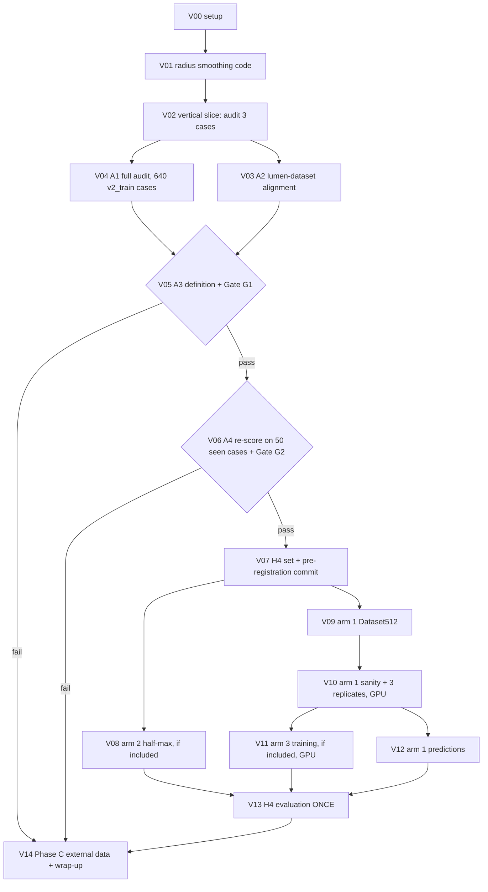

# TwinLoop v3 — Specification (stenosis reference audit, then H4)

Mode: EXPERIMENT. Machine: SPARK only. Branch: `v3`. Task list: docs/TASKS_V3.md.
Everything Sonnet needs is in this file; docs/SPEC_V2.md and the reports named below are background.
Where two ways are possible, the choice is marked **DEFAULT**.

---

## 0. Conventions and glossary

- **GT** = the ImageCAS ground-truth coronary label mask (`paths.case_label_path(id)`).
- **First-pass mask** = the deployed nnU-Net (Dataset501, fold 0, no TTA) prediction, stored at
  `/data/v2/firstpass/ImageCAS_XXXX.nii.gz` for every `v2_holdout` and `v2_realfail` case. Use
  `eval_v2.firstpass_path(cid)` to find it.
- **Graph** = `twinloop.graph.build_graph(mask, CenterlineParams(), GraphParams())` →
  `CoronaryGraph(trees, fragments, endings)`. Each `VesselTree` has `branches: dict[str, Branch]`;
  each `Branch` has `branch_id, parent_id, points_mm (N,3), radius_mm (N,), s_mm (N,), children`.
  Samples are 0.5 mm apart in arc length. v1 radius = inscribed (EDT) radius.
- **Lesion** = output of v1 `twinloop.lesions.detect_lesions(branch, LesionParams())`: fields
  `branch_id, start_idx, end_idx, min_idx, ds, r_min_mm, r_ref_mm, length_mm`. `ds` = diameter
  stenosis = 1 − r/r_ref, r_ref = 80th percentile radius over 10 mm (`reference_radius`). A lesion
  needs ds ≥ 0.25.
- **Bins** by ds: mild [0.25, 0.5), moderate [0.5, 0.7), severe [0.7, 1.0]; **modplus** = moderate +
  severe (ds ≥ 0.5).
- **ds_err_pp** = 100 · (ds_pred − ds_gt), from `metrics.stenosis_errors` (window rule, ±2 mm,
  match ≤ 2 mm). Negative = stenosis under-called.
- **min FFR of a case** = min over `tree_0` and `tree_1` of `eval_v2.min_ffr(result, tree_id)`
  (samples with diameter ≥ 1.5 mm); `None` values ignored; if both are `None`, the case's min FFR is
  `None` (counts as "not < 0.80").
- **Positive case** = reference (`gt_ref`, §5) min FFR < 0.80. **Negative** = ≥ 0.80.
- `cid` = integer ImageCAS case id. Paths below starting with `/data/` are container paths.
- All docker commands run via `./scripts/dk` (inside the image) unless they are `docker ...` itself.

## 1. Background facts (do not re-derive; all from committed reports on branch v2)

| Fact | Value | Source |
|---|---|---|
| First-pass Dice on regression set (20 cases) | 0.787 | reports/V2_RESULTS.md |
| `widened_rate` first-pass / GT blurred σ 0.25 mm (Dice 0.998) | 0.90 / 0.28 | reports/v2_diag2.md |
| Moderate+ mean ds_err_pp, inscribed: pred_v1 / GT blurred σ 0.5 mm | −51.2 / −47.7 | reports/v2b_results.md |
| down50 (inscribed): pred_v1 / GT blur σ 0.5 | 25/38 / 32/38 | reports/v2b_results.md |
| Cases with gt_v1 min FFR < 0.80 also < 0.80 for pred_v1 (30-case set) | 0 of 16 | reports/H3_RESULTS.md |
| Half-max lumen area vs label area at GT moderate / severe slices | 2.30× / 2.79× | reports/v3_lumen_reannot.md |
| Healthy slices: label 301 px, half-max 304 px, but AND of both 148 px | overlap ≈ 50 % | reports/v3_lumen_reannot.md |
| H1, H2, H3 | all FALSIFIED | V2_RESULTS.md, H3_RESULTS.md |

Interpretation that motivates v3: GT "stenoses" measured with the inscribed radius are mostly
voxel-scale dips that disappear under tiny smoothing, and the image intensity often does not show a
narrowing there. A pipeline judged against those dips cannot pass, whatever it does. v3 measures
this first.

## 2. Repo, data and case roles

### 2.1 Repo and outputs
- Worktree `twinloop-v3`, branch `v3` (created from `v2` by the owner before the session).
- v3 writes data only under `/data/v3/` and the new nnU-Net dataset folders named in §9.1
  (`Dataset512_ImageCASlesion`). Results for the repo go to `reports/` (CSV < 2 MB only).
- `src/twinloop/paths.py` gets one new function (V01):
```python
def v3_dir() -> Path   # data_root() / "v3"
```

### 2.2 Case roles (unchanged, `twinloop.v2split.load_roles()`)
| Role | Count | v3 use |
|---|---|---|
| test (`id % 5 == 0`) | 200 | never |
| `v2_train` | 640 | Phase A audit and selection; arm-1 fine-tuning data |
| `v2_train` with `id % 10 == 3` | 85 (verify) | "dev" cases: check-only in Phase A, smoke tests in Phase B |
| `v2_train` with `id % 10 != 3` | 555 (verify) | "sel" cases: Phase A selection (A3) |
| `v2_holdout` ∪ `v2_realfail` | 87 + 73 | see 2.3 |

### 2.3 Already-spent case sets (never part of the H4 set)
- Regression set, 20 cases: `reports/v2_regression_set.json` (seen in S13, S16, S18, S19, S20).
- H3 stenosis set, 30 cases: `reports/v3_stenosis_set.json` (seen in S24).
- These 50 cases are "seen". V06 uses them for an exploratory re-score and Gate G2. Allowed,
  because they are already spent and excluded from H4.
- `v2_realfail` cases were used to fine-tune the decider (v2). The decider plays no part in v3, and
  their first-pass masks were never scored for stenosis outside the 30-case set, so the remaining
  `v2_realfail` cases may join the H4 set.
- **H4 set** = (`v2_holdout` ∪ `v2_realfail`) minus the 50 seen cases. Expected size 110 (= 160 − 50).
  Verify the count in V07; if it differs, use the actual set and log it.

## 3. Phases, gates and flow



## 4. Shared definitions (exact)

### 4.1 Blurred GT mask
```python
def blur_mask(mask: sitk.Image, sigma_mm: float) -> sitk.Image
```
`a = sitk.GetArrayFromImage(mask) > 0` as float32 (z, y, x); `sp = mask.GetSpacing()` is (x, y, z);
`b = scipy.ndimage.gaussian_filter(a, sigma=(sigma_mm/sp[2], sigma_mm/sp[1], sigma_mm/sp[0]))`;
output `(b > 0.5).astype(uint8)` as a sitk image with `CopyInformation(mask)`. This is the same
procedure as S19 (`scripts/diag_v2b.py` on branch v3: read it and reuse its function if its
behaviour matches this text; otherwise implement this text). Put it in `src/twinloop/radius_smooth.py`
so tests can import it.

### 4.2 Radius-profile smoothing (the candidate "robust definition")
New module `src/twinloop/radius_smooth.py`:
```python
def smooth_radius(s_mm: np.ndarray, radius_mm: np.ndarray, sigma_mm: float) -> np.ndarray
    # sigma_mm <= 0: return radius_mm.copy().
    # Else Gaussian kernel regression in arc length:
    #   r_s[i] = sum_j w_ij r_j / sum_j w_ij,  w_ij = exp(-0.5 ((s_i - s_j)/sigma)^2),
    #   only j with |s_i - s_j| <= 3*sigma (+1e-9). Edges: same formula (weights renormalised).
def smooth_trees(trees: list[VesselTree], sigma_mm: float) -> None     # in place, every branch
def smooth_graph(graph: CoronaryGraph, sigma_mm: float) -> None        # trees and fragments
```
Worked examples (unit tests in V01 must reproduce them to 1e-3):
1. `s = 0, 0.5, …, 5.0` (11 samples), r = 2.0 everywhere except r[5] = 1.0 (one-sample 50 % dip).
   σ 0.5 → r_s = [2.0, 2.0, 1.9955, 1.946, 1.758, **1.6009**, 1.758, 1.946, 1.9955, 2.0, 2.0];
   σ 1.0 → r_s[5] = **1.7994**. With r_ref 2.0 the dip drops from ds 0.50 to 0.20 (σ 0.5): it is no
   longer a lesion.
2. `s = 0, 0.5, …, 20.0` (41 samples), r = 2.0 except r[17:24] = 1.0 (a 3 mm long 50 % narrowing).
   r_s[20] = **1.0** (σ 0.5), **1.076** (σ 1.0), **1.3793** (σ 2.0). A real 3 mm stenosis survives
   σ ≤ 1.0 mm.
3. Constant r = 1.7 → unchanged for every σ.

### 4.3 Definitions compared in Phase A
| id | radius | profile smoothing σ_s (mm) |
|---|---|---|
| D0 | inscribed (v1) | 0 (current v2 reference) |
| D1 | inscribed | 0.5 |
| D2 | inscribed | 1.0 |
| D3 | inscribed | 1.5 |
| D4 | inscribed | 2.0 |
Under definition Dk, **every** graph is smoothed with σ_s before lesion detection or scoring: the GT
graph, the blurred-GT graph and every prediction's graph; and the pipeline solves with smoothed
radii (`V2Options.radius_smooth_mm = σ_s`), so the FFR reference changes too.
Area-equivalent radii are not compared (D-V3-04).

### 4.4 Lesion survival under blur
For definition Dk and blur σ_b ∈ {0.25, 0.5}: `g_gt` = GT graph smoothed σ_s; `g_b` = graph of
`blur_mask(GT, σ_b)` smoothed σ_s; rows = `metrics.stenosis_errors(g_gt, g_b, LesionParams())`.
A GT lesion **survives** σ_b if `missed` is False and
`ds_pred ≥ 0.5` (when `ds_gt ≥ 0.5`) or `ds_pred ≥ 0.25` (when `ds_gt` is mild).
**Retention(Dk, σ_b)** = survivors / all GT lesions with `ds_gt ≥ 0.5`, pooled over cases.

### 4.5 Image support of a lesion
For each GT lesion (under Dk), on its GT branch, CPR-straighten image and GT mask together:
`res = twinloop.cpr.straighten(image, gt_mask, branch, V2Params().cpr)` (verify in V02 that the
second argument accepts a mask and what key the straightened mask has: read `cpr.py`; `lumen.py`
calls `straighten(image, None, b, cp)` and reads `res["img"]`, `res["s_mm"]`). Slices are 48×48 px,
0.2 mm, every 0.5 mm.
- `auto` per slice = half-maximum mask, algorithm moved from `scripts/make_lumen_reannot.py`
  `auto_mask` into `src/twinloop/halfmax.py` as `auto_mask(hu: np.ndarray) -> np.ndarray` with one
  fix: when the centre label `k` is 0 it returns an all-False (48, 48) array (the old code returned
  the scalar `False`). Input HU clipped to [−200, 800] first.
- `lab` per slice = `cpr.center_component(straightened GT mask slice > 0.5)`.
- **min slices** = slices with |s − s_min| ≤ 0.5 mm (s_min = branch.s_mm[min_idx]); **ref slices**
  = slices with 3 ≤ distance outside the lesion run ≤ 8 mm, on both sides (the run is
  [s_mm[start_idx], s_mm[end_idx]]), whose GT ds < 0.25, where GT ds at a slice = 1 − r/r_ref with
  r and r_ref = `lesions.reference_radius(b.s_mm, b.radius_mm, LesionParams())` of the smoothed GT
  branch, interpolated to the slice's `s` with `np.interp`.
- `image_ds = 1 − sqrt(median auto area over min slices / median auto area over ref slices)`,
  clipped to ≥ 0; NaN if there are no ref slices or the ref median is 0.
- `label_area_ds` = same formula with `lab` areas.
- `calcified` = any min slice has an unclipped HU ≥ 800 within 2.0 mm of the slice centre.
- `iou_ref` = median over ref slices of IoU(auto, lab); NaN if no ref slices.
- **Image-supported** = `image_ds ≥ 0.25`. Counted only for non-calcified lesions (half-max is
  inflated by calcium). Image-supported fraction = image-supported / non-calcified lesions with a
  non-NaN `image_ds`.
- **Half-max method usable** (decides arm 2, §9.3) = median of `iou_ref` over all D0 lesions of the
  640 cases ≥ 0.60.

### 4.6 Junction distance
`dist_junction_mm` = arc distance from `s_min` to the nearest branch end that is a junction (the
start if `parent_id` is not None, the end if `children` is non-empty); `inf` if neither is.

## 5. Code changes to the pipeline (V01, V08)

`V2Options` (`src/twinloop/pipeline.py`) gets two fields, both default off:
```python
radius_smooth_mm: float = 0.0   # §4.2 profile smoothing before lesions and solver (0 = off)
halfmax: bool = False           # arm 2 (§9.3): narrow radii to the half-max lumen
```
Order inside `run_pipeline` after `extract_trees`: area_eq (existing, off) → lumen refinement
(existing) → **halfmax** (`halfmax_narrow`, new) → **smoothing** (`smooth_trees`, new) → lesion
detection → solver. With both fields at default, every output is byte-identical to before (test).
No CLI flags, no `result.json` field changes, no `schema.py` change.

## 6. Phase A — audit the reference (CPU only, `v2_train` cases)

### 6.1 A2: lumen-dataset alignment (V03)
Question: why do the half-max mask and the stored label overlap only ≈ 50 % on healthy slices?
Script `scripts/v3_a2_alignment.py`. Data `/data/v2/datasets/lumen/*.npz` (keys `img` normalised as
(HU − 300)/500 after clipping, `mask`, `ds`, `case_id`, `jitter`; read `train/train_lumen.py`
`list_files` for how files are named and which are "clean" vs "jit"). Steps:
1. Sample 200 files with `numpy.random.default_rng(0).choice(sorted(files), 200, replace=False)`.
2. For each file, healthy slices (ds < 0.25, NaN counted as healthy), at most 50 per file
   (first 50 in order): `hu = img*500 + 300`, `auto = auto_mask(hu)`, `lab = mask > 0`.
3. For each of 8 transforms of `lab` (identity, flip axis 0, flip axis 1, transpose, rot90 k=1,2,3,
   transpose+flip axis 0) and every integer shift (dy, dx) ∈ [−3, 3]², compute IoU(auto, T(lab)). Shift with zero fill
   (`scipy.ndimage.shift(x, (dy, dx), order=0, cval=0)`), never `np.roll`. IoU of two empty masks is
   skipped (not counted).
4. Report: median IoU at identity/no shift; the (transform, shift) with the highest median IoU and
   that median; split by clean vs jit files.
5. Fresh reference: 20 branches from 5 `v2_train` dev cases (the first 5 dev ids, first 4 branches
   ≥ 10 mm each): straighten image + GT mask with `cpr.straighten` (§4.5) and compute the identity
   median IoU(auto, lab) on healthy slices the same way.
**Outcome rule (pre-set):** `dataset_aligned` = identity median IoU on the dataset ≥ 0.60.
Write `reports/v3_A2_alignment.md` with the tables and one of these verdict lines:
- aligned (≥ 0.60);
- "misaligned: best transform <T, shift> gives <x>" when identity < 0.60 and the best ≥ 0.60
  (this means LumenNet v1/v3 were trained on misaligned labels: state it plainly);
- "shape mismatch" when both are < 0.60 (half-max and label disagree in shape, not position).
Also write `reports/v3_A2_alignment.json`: `{"identity_median_iou": x, "best_transform": "...",
"best_shift": [dy, dx], "best_median_iou": y, "fresh_identity_median_iou": z, "dataset_aligned": bool}`.
Nothing is retrained or changed in A2.

### 6.2 A1: lesion audit (V02 slice, V04 full)
Script `scripts/v3_lesion_audit.py --cases <all|first3|dev|sel> --sigmas 0,0.5,1.0,1.5,2.0
--out /data/v3/audit/lesions.csv [--workers 8]`. Resumable: skip `(case_id)` already in the CSV.
Per case: load image, GT; build GT graph once; build blurred graphs (σ_b 0.25 and 0.5) once; for
each σ_s copy the three graphs (`copy.deepcopy`), smooth them, detect lesions on the GT copy, score
survival (§4.4), compute image support (§4.5) and junction distance (§4.6).
CSV columns (one row per GT lesion per σ_s; a failed case writes one row with `status=failed`):
```
case_id,sigma_s,lesion_id,branch_id,ds_gt,bin,r_min_mm,r_ref_mm,length_mm,dist_junction_mm,
ds_b025,missed_b025,survive_b025,ds_b05,missed_b05,survive_b05,
image_ds,label_area_ds,calcified,iou_ref,status,error
```
Example row: `236,1.0,tree_0_b3_p41,tree_0_b3,0.553,moderate,0.71,1.59,3.5,12.0,0.541,False,True,
0.47,False,False,0.38,0.52,False,0.71,ok,`
`lesion_id` = `f"{branch_id}_p{min_idx}"`. `bin` uses `ds_gt` (the window value from
`stenosis_errors`). Booleans are `True`/`False`, NaN as empty cell.
Report script `scripts/v3_audit_report.py --csv /data/v3/audit/lesions.csv [--out <md>]` writes
`--out` (**DEFAULT** `reports/v3_A1_lesion_audit.md`) with, per σ_s and per subset (sel, dev, all):
| σ_s | bin | n lesions | lesions/case | survive σ_b 0.25 | survive σ_b 0.5 | calcified | image-supported (non-calc.) | median image_ds | median label_area_ds | dist_junction < 3 mm |
and one line: median `iou_ref` over all D0 lesions, and `halfmax_usable` (§4.5).

### 6.3 A3: choose the definition and Gate G1 (V05)
Computed by `scripts/v3_audit_report.py --select` on **sel** cases only (dev cases are reported but
never used to choose):
- `count(Dk)` = number of modplus GT lesions under Dk; `retention(Dk)` = Retention(Dk, σ_b = 0.5).
- **Qualifying** definitions: `retention ≥ 0.80` and `count(Dk) ≥ 0.40 · count(D0)`.
- **σ\*** = the smallest σ_s among qualifying definitions (smallest change to the reference).
- **Gate G1 PASSES** if a qualifying definition exists AND, under σ\*, the image-supported fraction
  of non-calcified modplus lesions ≥ 0.50 **or** `halfmax_usable` is False (image support then
  cannot be measured; record "G1 passed on robustness only").
- Write `reports/v3_definition.json`: `{"sigma_s_mm": σ*, "retention": r, "count": n, "count_d0": n0,
  "image_supported_frac": f, "halfmax_usable": bool, "dataset_aligned": bool, "g1": "pass"|"fail",
  "g1_reason": "..."}` and `reports/v3_A3_definition.md` (selection table for all Dk on sel and dev,
  then the verdict). If G1 fails, `sigma_s_mm` is null.
- G1 fail → mark V06–V13 `[x] skipped (G1 failed)` and go to V14.

### 6.4 A4: re-score the 50 seen cases and Gate G2 (V06)
`scripts/eval_v3.py` (§10) on the 50 seen cases with variants `gt_ref, gt_blur025, gt_blur05,
pred_v1` at σ_s = 0 and σ_s = σ\*. Report `reports/v3_A4_rescore.md`: per σ_s and variant, positives
(gt_ref min FFR < 0.80), sensitivity, false-positive rate, modplus mean ds_err_pp, down50.
- **Gate G2 PASSES** if, at σ\*, sensitivity(gt_blur05) ≥ 0.50, or there are fewer than 5 positives
  among the 50 cases (then record "G2 not assessable, passed by rule").
- Rationale: `gt_blur05` is a near-perfect, slightly smooth segmentation. If even it cannot reproduce
  half of the reference's positive calls, no segmentation fix can pass H4.
- G2 fail → mark V07–V13 `[x] skipped (G2 failed)` and go to V14.

## 7. H4 — pre-registered hypothesis (fixed by this spec; V07 commits the case set before training)

**H4:** Under the robust stenosis definition σ\*, at least one arm detects significantly more of the
reference-positive cases than the first-pass pipeline, without unacceptable side effects.

- **Independent variable:** pipeline arm (pred_v1 comparator; arms 1, 2, 3).
- **Dependent variables:** case-level sensitivity, false-positive rate, modplus mean ds_err_pp,
  down50, branch recall.
- **Controlled:** σ_s = σ\* for every row; `radius_mode="inscribed"`, `anatomy=False`,
  `flow_mode="diameter_law"`, aortic pressure 90 mmHg, no repair; same H4 cases; GT lesions from the
  GT graph smoothed with σ\*; same metric code.
- **Baselines:** `pred_v1` (comparator); `gt_blur05` (ceiling for a smooth segmentation, no verdict);
  arm 2 is the simplest non-learned fix.
- **Per-arm verdict** (arm judged alone; with replicates, an arm is SUPPORTED only if ≥ 2 of its 3
  replicates meet every condition; a killed replicate counts as not meeting them; otherwise
  FALSIFIED):
  - PRIMARY: sens(arm) − sens(pred_v1) ≥ +0.25 AND sens(arm) ≥ 0.40.
  - GUARD (a): FPR(arm) − FPR(pred_v1) ≤ +0.10.
  - GUARD (b): modplus mean ds_err_pp(arm) − modplus mean ds_err_pp(pred_v1) ≥ +10 pp.
  - GUARD (c): mean branch recall(arm) ≥ mean branch recall(pred_v1) − 0.02.
  - GUARD (d): down50(arm) ≤ down50(pred_v1) (SPEC_V2 §13b standing guard).
  - **H4 SUPPORTED** if any arm is SUPPORTED. **INCONCLUSIVE** if the H4 set has fewer than 10
    positives (known at V07 from GT only). Otherwise **FALSIFIED**.
- No multiplicity correction (up to 3 arms); state this in the report.
- Report-only: paired bootstrap 95 % CI of sens(arm) − sens(pred_v1) over positive cases (2000
  resamples, `numpy.random.default_rng(0)`, percentile 2.5/97.5); false_sig_lesions per arm.

**Falsified means:** no arm meets all five conditions with the required replicate count.

## 8. Metrics (exact formulas)
Over the H4 cases where the `gt_ref` row has `status=ok` (cases with a failed `gt_ref` row are
excluded from every variant and listed):
- `P` = cases with gt_ref min FFR < 0.80; `N` = the rest.
- `sens(v)` = |{c ∈ P : min FFR_v(c) < 0.80}| / |P|. A failed or `None` variant row counts as
  "not < 0.80".
- `FPR(v)` = |{c ∈ N : min FFR_v(c) < 0.80}| / |N|.
- modplus mean ds_err_pp = mean of `ds_err_pp` over all lesion rows of v with bin moderate or severe
  and `missed=False`, pooled over cases (not a mean of case means).
- `down50` = count of lesion rows with `ds_gt ≥ 0.5`, not missed, `ds_pred < 0.5`.
- `branch_recall` = `metrics.branch_recall(g_gt_unsmoothed, final_mask)`, mean over cases.

## 9. Arms

### 9.1 Arm 1 — segmenter fine-tuned with a lesion class (always included)
Idea: a second label class marks GT vessel voxels at lesions. nnU-Net then (a) oversamples patches
around lesions (its foreground sampling picks a class, then a voxel of it) and (b) gives lesion
voxels their own Dice term. No nnU-Net code changes.
- **Dataset** `Dataset512_ImageCASlesion` (V09), `v2_train` cases only (640): images = symlinks to
  Dataset501 `imagesTr` files; labels written new: 0 background, 1 vessel, 2 lesion zone.
  Lesion zone = GT vessel voxels within distance (r_ref_mm + 1.0 mm) of any centerline point of a GT
  lesion run extended by 2.0 mm of arc on each side, using all GT lesions (ds ≥ 0.25) under σ\*.
  Compute with a voxel EDT from the marked centerline voxels (`scipy.ndimage.distance_transform_edt`
  with `sampling=(sz, sy, sx)`), points → voxels with `image.TransformPhysicalPointToIndex`.
  Write each label on the grid of the Dataset501 raw label file (`sitk.ReadImage`, then
  `CopyInformation`); assert size, spacing, origin and direction equal the raw image's.
  `dataset.json`: `{"channel_names": {"0": "CT"}, "labels": {"background": 0, "vessel": 1,
  "lesion": 2}, "numTraining": 640, "file_ending": ".nii.gz"}`.
- **Plans**: copy Dataset501's `nnUNetPlans.json` to `/data/nnUNet_preprocessed/Dataset512_ImageCASlesion/`
  with `dataset_name` changed (same method as `scripts/xfit_setup.py`, read it first), so patch
  size, spacing and CT normalisation are identical. Then `nnUNetv2_preprocess -d 512 -plans_name
  nnUNetPlans -c 3d_fullres -np 8` (if it demands a fingerprint, run `nnUNetv2_extract_fingerprint
  -d 512 -np 8` first and log it).
- **Split**: `/data/nnUNet_preprocessed/Dataset512_ImageCASlesion/splits_final.json` = a JSON list with
  one dict `{"train": ["ImageCAS_0001", ...], "val": [...]}`: train = `v2_train` with `id % 10 != 3`,
  val = dev (`id % 10 == 3`). Same format as Dataset501's file. `v2_holdout`, `v2_realfail` and test cases are not in the dataset at all.
- **Training**: 3 replicates k = 0, 1, 2 (nnU-Net exposes no seed; replicates differ by random init
  of the new output layer and data order), each:
  `nnUNet_results=/data/v3/nnunet_results/rep{k} nnUNetv2_train 512 3d_fullres 0 -tr
  nnUNetTrainer_250epochs -pretrained_weights /data/nnUNet_results/Dataset501_ImageCAS/nnUNetTrainer__nnUNetPlans__3d_fullres/fold_0/checkpoint_final.pth`.
  Use `checkpoint_final.pth` (no selection on any validation score).
- **Inference**: `nnUNetv2_predict -d 512 -c 3d_fullres -f 0 -tr nnUNetTrainer_250epochs
  --disable_tta -chk checkpoint_final.pth` with `nnUNet_results` set per replicate; output labels
  {0,1,2} → binary mask `label > 0`, saved uint8 to `/data/v3/pred/arm1_rep{k}/ImageCAS_XXXX.nii.gz`
  with the image's geometry. Input folder of symlinks as in `scripts/predict_firstpass.py`.
- Pipeline for arm 1 rows: arm-1 mask, the controlled options of §7.

### 9.2 Arm 3 — LumenNet on the re-annotated dataset (only if `dataset_aligned` is True)
Train `train/train_lumen_v3.py --data /data/v2/datasets/lumen_reannot --out
/data/v3/runs/lumen_reannot/seed{k} --seed {k}` for k = 0, 1, 2 (its existing recipe: 30 000
steps, batch 4, kill criterion built in). Export each seed as model folder
`/data/models/v2/lumen_v3_reannot_s{k}` the way S23 exported `lumen_v3` (read
`git show 749b841 --stat` and `train/export_models.py`). Inference: `V2Options(lumen=True,
lumen_model="lumen_v3_reannot_s{k}", lumen_radius_out="ins", lumen_fallback="interp",
lumen_sigma=0.0)` + controlled options. If `dataset_aligned` is False, arm 3 is excluded and V11
is `[x] skipped (dataset not aligned, V03)`.

### 9.3 Arm 2 — half-max narrowing (only if `halfmax_usable` is True; no learning)
`src/twinloop/halfmax.py`:
```python
def auto_mask(hu: np.ndarray) -> np.ndarray          # §4.5 (moved + fixed)
def halfmax_narrow(trees: list[VesselTree], image: sitk.Image, cp: CprParams,
                   calcium_hu: float = 800.0, calcium_radius_mm: float = 2.0) -> dict
```
For every branch with `s_mm[-1] ≥ cp.min_branch_len_mm`: `res = straighten(image, None, b, cp)`;
per slice `r_hm = r_ins_2d_mm(center_component(auto_mask(clip(hu))), cp.pixel_mm)` (0 if empty);
`r_v1 = np.interp(res["s_mm"], b.s_mm, b.radius_mm)`; slice calcified as §4.5; new slice radius =
`min(r_v1, r_hm)` if not calcified and `r_hm > 0`, else `r_v1`; then
`b.radius_mm = np.interp(b.s_mm, res["s_mm"], r_new)`. Returns `{"n_slices", "n_narrowed",
"n_calcified"}`. Radii only ever decrease. All constants fixed here; nothing is tuned.

## 10. Evaluation script `scripts/eval_v3.py`
```
eval_v3.py --cases seen|h4|dev10 --variants <comma list> --sigma <float> --out <cases.csv>
           --lesions-out <lesions.csv> [--shard K/N] [--limit N]
```
- Case lists: `seen` = regression ∪ stenosis set (50); `h4` = `reports/v3_h4_set.json`; `dev10` =
  the first 10 dev ids in ascending order.
- Variants (mask source; all use the controlled options of §7 with `radius_smooth_mm = --sigma`):
  `gt_ref` (GT), `gt_blur025` / `gt_blur05` (§4.1, σ_b 0.25 / 0.5), `pred_v1` (first-pass),
  `arm1_rep0..2` (§9.1 masks), `arm2_halfmax` (first-pass + `halfmax=True`),
  `arm3_s0..2` (first-pass + §9.2 lumen). For `dev10`, `pred_v1` / `arm2` / `arm3` use the
  `gt_blur05` mask as input (dev cases have no first-pass mask; smoke only).
- Case dirs `/data/v3/eval/<variant>/s<sigma>/<cid:04d>`; `run_pipeline(image, mask, PipelineParams(),
  case_dir, ...)` with mask given, as in `eval_v2.eval_one`.
- `g_gt` = `build_graph(GT)` deep-copied then `smooth_graph(σ)`; pred graph = `eval_v2.graph_from_result`
  (already smoothed by the pipeline). Lesion rows = `metrics.stenosis_errors(g_gt, g_pred, LesionParams())`
  plus `case_id, variant, sigma`.
- Cases CSV columns: `case_id,variant,sigma,status,dice,branch_recall,min_ffr,min_ffr_tree0,
  min_ffr_tree1,n_lesions_gt,n_modplus_gt,false_sig_lesions,t_total,error`.
  Example: `1,pred_v1,1.0,ok,0.812,0.95,0.862,0.862,0.941,5,2,1,9.4,`
- Lesions CSV columns: `case_id,variant,sigma,lesion_id,ds_gt,ds_pred,ds_err_pp,rmin_gt,rmin_pred,
  rmin_err_mm,missed,bin,ds_lesion,rmin_lesion`.
- Resumable (skip existing `(case_id, variant, sigma)`); failures recorded with `status=failed`.
- Imports from v2's script: `sys.path.insert(0, str(REPO / "scripts"))`, then
  `from eval_v2 import firstpass_path, graph_from_result, min_ffr` (same trick as
  `scripts/make_stenosis_set.py`). Do not edit `eval_v2.py`.
- `scripts/v3_h4_report.py --cases <csv> --lesions <csv> --prereg reports/v3_h4_prereg.json
  --out reports/V3_RESULTS.md` computes §8 metrics and the §7 verdicts. The same functions produce
  the A4 tables (`--mode a4`).

## 11. Sanity checks, seeds, budget, kill criteria
- **Unit tests (CPU)**: §4.2 worked examples; `smooth_*` in place and no-op at σ 0; `blur_mask` keeps
  geometry and returns 0/1; pipeline with default `V2Options` byte-identical `result.json` to a run
  without the new code paths on the `stenosis` phantom (compare files); `auto_mask` returns a
  (48, 48) bool array for a blank slice; `halfmax_narrow` never increases a radius (phantom).
- **Arm 1 sanity (V10)**: one run of `nnUNetTrainer_5epochs` with the same pretrained weights into
  `/data/v3/nnunet_results/sanity`: the log's epoch-0 train loss is finite; at epoch 4 the first
  pseudo-Dice value (vessel class) is ≥ 0.5 (pretrained init); prediction of 1 dev case has label
  values ⊂ {0, 1, 2}. Delete nothing afterwards.
- **Arm 3 sanity**: the script's own kill check (moderate+ r_ins error > 0.5 mm at 25 % of steps).
- **Seeds**: arm 1 three replicates; arm 3 seeds 0, 1, 2; every sampling uses
  `numpy.random.default_rng(0)`; bootstrap seed 0.
- **Per-run limits**: arm-1 replicate 12 h wall (stop with `docker stop` at 12 h, mark killed);
  arm-3 seed 3 h; audit 4 h; any eval run 8 h. **Total GPU budget 96 h** (expected use ≈ 45 h:
  preprocessing 1 h CPU, sanity 0.5 h, 3 × (250 × ≈105 s ≈ 7.3 h + final validation ≈ 1.5 h),
  predictions 3 × (10 + 110 cases) ≈ 6 h, arm 3 ≈ 2 h).
- **Kill criteria**: arm-1 replicate: at epoch 50, vessel pseudo-Dice (first value of the
  "Pseudo dice" line for epoch 50 in `fold_0/training_log_*.txt` under that replicate's
  `nnUNet_results`) < 0.70 → stop it, mark killed. If 2 or more replicates are
  killed, arm 1 is "failed to train" (FALSIFIED in the report, reason stated). nnU-Net's final
  validation crashing after `checkpoint_final.pth` exists is not a failure (known issue D42 of v1):
  log it and continue.
- **Smoke before H4 (report-only, but fix bugs before V13)**: `dev10` run of every included arm
  must finish with `status=ok` for ≥ 9 of 10 cases, and arm-1 Dice vs GT ≥ 0.60 on each ok case.

## 12. Files v3 creates
`src/twinloop/radius_smooth.py`, `src/twinloop/halfmax.py`, `paths.v3_dir` (edit), `pipeline.py`
(two fields + two calls), `tests/test_radius_smooth.py`, `tests/test_halfmax.py`,
`tests/test_pipeline_v3.py`; scripts `v3_lesion_audit.py`, `v3_audit_report.py`, `v3_a2_alignment.py`,
`eval_v3.py`, `v3_h4_report.py`, `v3_make_h4_set.py`, `v3_dataset512.py`, `v3_train_arm1.sh`,
`v3_predict_arm1.py`; reports named in §6–§10 and `reports/v3_arm1_training.md`,
`reports/v3_arm3_training.md`, `reports/V3_RESULTS.md`, `reports/v3_external_data.md`.

## 13. Results template (`reports/V3_RESULTS.md`, filled in V13)
```
# TwinLoop v3 results — H4
Date, commit, σ* (mm), arms included (and why others were excluded), H4 set size, P, N.
FFR values are unvalidated research output. Evaluated once; nothing changed after seeing results.

| variant | ok/total | sens | FPR | modplus mean ds_err_pp | down50 | mean branch recall | false_sig |
| pred_v1 | ... |
| gt_blur05 (ceiling, no verdict) | ... |
| arm1_rep0 / rep1 / rep2 | ... |
| arm2_halfmax | ... |
| arm3_s0 / s1 / s2 | ... |

| arm | condition | value | comparator | diff | holds |   (one block per arm / replicate)

Bootstrap 95 % CI of sens difference per arm. Verdict per arm, then H4: SUPPORTED / FALSIFIED / INCONCLUSIVE.
Failures (case, variant, error). Caveats: reference is GT-mask derived, not invasive FFR or QCA;
single centre; σ* chosen on v2_train; no multiplicity correction; n.
```

## 14. Phase C — external reference data (V14; research only)
Run V14's research part if G1 or G2 failed, or if H4 is not SUPPORTED. Write
`reports/v3_external_data.md`: for each candidate, name, what reference it has (QCA, invasive FFR,
expert stenosis grades), number of cases, licence, how to request access, current availability with
the URL and date checked. Start with the Rotterdam Coronary Artery Stenosis Detection and
Quantification Evaluation Framework (Kirişli et al., Medical Image Analysis 2013; QCA reference).
Its availability today is UNCERTAIN: verify with web search. Then search for other public CCTA
datasets with stenosis grades or FFR. No downloads, no registrations, no emails. Each claim needs a
URL; say "not found" rather than guessing.

## 15. Honesty and integrity rules
- Report every number as computed, including failures, killed runs and gates that fail.
- Never tune on the H4 set, the 50 seen cases (beyond the fixed G2 rule) or the test split.
- `reports/v3_h4_set.json` and `reports/v3_h4_prereg.json` are committed before any Phase B
  training starts and are never edited afterwards.
- H4 runs once. If V13 crashes midway, resume the same command (resumable CSV); do not change code
  between partial runs except to fix a crash, and log any such fix in DECISIONS_V3 before resuming.

## 16. Uncertain facts and how to verify them
| Fact | How to verify |
|---|---|
| `cpr.straighten(image, mask, branch, cp)` accepts a mask and returns its straightened copy | Read `src/twinloop/cpr.py`; if not, use what `scripts/diag_v2b.py` (S19) does for GT-mask CPR |
| `nnUNetv2_train -pretrained_weights` skips the output layer when class counts differ | Read `nnunetv2/run/load_pretrained_weights.py` in the container (`python -c "import nnunetv2,os;print(os.path.dirname(nnunetv2.__file__))"`); expect a skip list containing `.seg_layers.`. If it does not skip, log it and load by a minimal trainer subclass in `scripts/` that drops `seg_layers` keys |
| `nnUNetv2_preprocess` needs a fingerprint | Run it; on a missing-fingerprint error run `nnUNetv2_extract_fingerprint -d 512 -np 8` |
| Dev count 85, sel count 555, H4 set 110 | Print in V00 / V07 |
| `nnUNetTrainer_250epochs` exists | `grep -r "class nnUNetTrainer_250epochs" $(python -c "import nnunetv2,os;print(os.path.dirname(nnunetv2.__file__))")` |
| How `scripts/dk` mounts the repo | `cat scripts/dk`; check `./scripts/dk head -1 CLAUDE.md` prints the v3 title |
